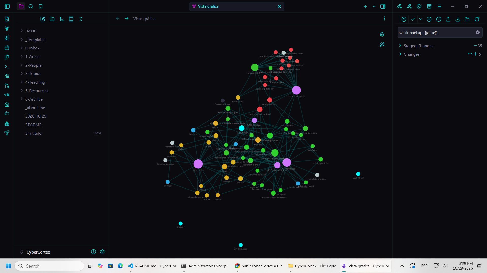

<p align="center">
  
</p>

<p align="center">
  
  
  
  
  
</p>

---

```
 ██████╗██╗   ██╗██████╗ ███████╗██████╗  ██████╗ ██████╗ ██████╗ ████████╗███████╗██╗  ██╗
██╔════╝╚██╗ ██╔╝██╔══██╗██╔════╝██╔══██╗██╔════╝██╔═══██╗██╔══██╗╚══██╔══╝██╔════╝╚██╗██╔╝
██║      ╚████╔╝ ██████╔╝█████╗  ██████╔╝██║     ██║   ██║██████╔╝   ██║   █████╗   ╚███╔╝ 
██║       ╚██╔╝  ██╔══██╗██╔══╝  ██╔══██╗██║     ██║   ██║██╔══██╗   ██║   ██╔══╝   ██╔██╗ 
╚██████╗   ██║   ██████╔╝███████╗██║  ██║╚██████╗╚██████╔╝██║  ██║   ██║   ███████╗██╔╝ ██╗
 ╚═════╝   ╚═╝   ╚═════╝ ╚══════╝╚═╝  ╚═╝ ╚═════╝ ╚═════╝╚═╝  ╚═╝   ╚═╝   ╚══════╝╚═╝  ╚═╝
```

<p align="center">
  <strong>🧠 Knowledge Graph · Second Brain · Neural Network</strong><br/>
  <em>Toda mi vida profesional y personal, conectada y accesible.</em>
</p>

---

## 🔮 ¿Qué es CyberCortex?

**CyberCortex** es mi vault de [Obsidian](https://obsidian.md/) — un **segundo cerebro** que conecta proyectos, docencia, finanzas, vida personal y desarrollo profesional en un grafo de conocimiento vivo.

Cada nota está enlazada con `[[wikilinks]]`, tiene **metadatos YAML** y se organiza en una estructura PARA modificada. El resultado: un grafo neural donde todo se conecta.

<p align="center">
  
</p>

<p align="center">
  <em>Vista del grafo de conocimiento — cada color representa un dominio diferente</em>
</p>

---

## 📂 Estructura del Vault

```
CyberCortex/
│
├── 📥 0-Inbox/          → Captura rápida — se procesa después
├── 🚀 1-Areas/          → Proyectos activos y áreas de responsabilidad
├── 👥 2-People/         → Personas clave — contactos, colegas, familia
├── 🎯 3-Topics/         → Dominios de conocimiento — fitness, inversiones, gaming...
├── 🎓 4-Teaching/       → Módulos docentes — ASO, SRI, IAW, PSP, Máster...
├── 📚 5-Resources/      → Referencias, links, material externo
├── 🗄️ 6-Archive/        → Proyectos cerrados o descartados
├── 📝 _Templates/       → Plantillas (proyecto, módulo, persona, topic)
└── 🗺️ _MOC/             → Maps of Content — índices temáticos
```

---

## 🗺️ Maps of Content (MOC)

Los MOCs son las **páginas hub** que conectan las notas por dominio:

| MOC | Descripción |
|-----|-------------|
| `MOC-Docencia` | Todos los módulos, cursos y actividad docente |
| `MOC-Proyectos` | Proyectos de desarrollo — activos, en pausa, completados |
| `MOC-Marca-Personal` | Estrategia de contenido, canales y visibilidad |
| `MOC-Finanzas` | Inversiones, vivienda e ingresos |
| `MOC-Vida` | Salud, relaciones, ocio y vida práctica |

---

## ⚡ Quick Stats

```
📝 69 notas
🔗 200+ wikilinks
🗺️ 5 MOCs
📝 4 plantillas
🚀 27 proyectos/áreas
🎓 12 módulos docentes
👥 4 personas
🎯 15 topics personales
```

---

## 🔄 Sync (Git)

Este vault se sincroniza entre máquinas vía Git.

```bash
# ⬇️ Antes de trabajar
git pull

# ⬆️ Al terminar
git add -A && git commit -m "sync $(date +%Y-%m-%d)" && git push
```

---

## 🧩 Plugins Recomendados

| Plugin | Para qué |
|--------|----------|
| **Graph Analysis** | Visualizar conexiones entre notas |
| **Dataview** | Consultas tipo SQL sobre metadatos YAML |
| **Templater** | Plantillas con variables `{{title}}`, `{{date}}` |
| **Smart Connections** | IA para encontrar notas relacionadas |
| **Canvas** | Tableros visuales con notas |

---

## 🛠️ Stack

<p>
  
  
  
  
</p>

---

<p align="center">
  <strong>「 CyberCortex 」</strong><br/>
  <em>Built by <a href="https://github.com/HEO-80">HEO-80</a> · Powered by Obsidian · Synced with Git</em><br/><br/>
  
</p>